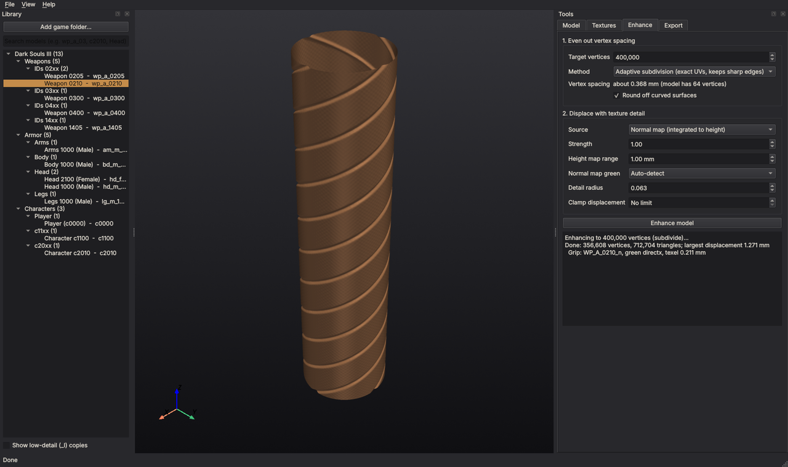
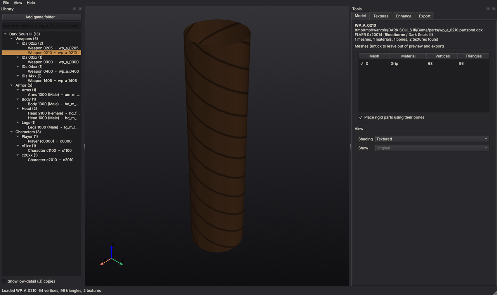

# Dark STL

Browse the models of Dark Souls, Bloodborne, Sekiro and Elden Ring (or any OBJ file), add the
surface detail their textures describe, and export print-ready meshes.



The game models are low-poly: most of their detail lives in normal maps. Dark STL turns that
detail into real geometry in three steps:

1. **Even out the vertices** to a target count, so flat areas get as many vertices as busy ones.
   Curved surfaces are rounded off along the model's own shading normals.
2. **Displace** every vertex by the height the normal map (or a height map) describes, at the
   physical scale the texture implies.
3. **Export** to STL, OBJ (with textures), PLY or GLB, in millimetres by default.

See [docs/PLAN.md](docs/PLAN.md) for how each step works, the file formats, and the roadmap.

## Status

Early. All readers and all three steps work and are tested against synthetic game files built
to the published format descriptions. Dark Souls Remastered weapons have been checked on real
files; the other games come next (Phase 1 of the plan).

Importing is modular: each game family has its own importer, and everything after import
(the explorer, the three steps, export) is shared. FromSoftware files and Wavefront OBJ are
supported today.

## Install

Python 3.10 or newer.

```
git clone https://github.com/DrFlGd/Dark-STL.git
cd Dark-STL
pip install -e ".[gui,remesh]"
```

`gui` adds the explorer window (PySide6 and VTK); `remesh` adds the optional isotropic
remesher. The command line works with neither.

## Getting the game files

Dark STL reads the files as the community unpackers leave them; it does not read the games'
encrypted archives directly.

- **PC games:** unpack them with the usual community unpacker for each game (UXM Selective
  Unpacker, or UDSFM for Dark Souls PTDE). Models end up in `parts/`, `chr/`, `obj/` or
  `asset/`, and `map/` as `.dcx` files, which Dark STL opens as they are.
- **Bloodborne:** use the extracted `dvdroot_ps4` folder from your own console dump.
- Folders unpacked further with WitchyBND or Yabber (`wp_a_0210-partsbnd-dcx/`) work too.
- **Sekiro and Elden Ring** compress with Oodle. Dark STL uses the `oo2core_6_win64.dll`
  that ships with the game. It is found automatically when the model files are inside the
  unpacked game folder; otherwise point to it with *File > Set Oodle DLL* (or `--oodle`).

## Using the explorer

```
darkstl            # or darkstl-gui, or python -m darkstl
```

1. *File > Add game folder* and pick the extracted game folder. Models appear grouped by game,
   type (weapons, armor, characters, objects, map pieces) and ID range. Type in the search box
   to filter.
   *File > Open model file* opens a single file, including `.obj`.
2. Click a model to preview it. If the file holds several models (a weapon and its sheath),
   pick one at the top of the *Model* tab. *Textures* shows the maps that were found and which one each
   material will use for detail; you can change it there.
3. On *Enhance*, set the target vertex count and click *Enhance model*. The tab shows the
   vertex spacing that count gives on this model, so you can match it to your printer.
4. On *Export*, pick the format and units.



## Command line

```
darkstl scan "D:/Games/DARK SOULS III/Game"              # list models by game and type
darkstl info parts/wp_a_0210.partsbnd.dcx                # models, parts, materials, textures
darkstl textures parts/wp_a_0210.partsbnd.dcx -o tex/    # save every texture as PNG
darkstl export parts/wp_a_0210.partsbnd.dcx -o grip.obj  # original model with textures
darkstl enhance parts/wp_a_0210.partsbnd.dcx -o grip.stl -n 2000000
darkstl enhance chr/c2010.chrbnd.dcx -o c2010.stl -n 4000000 --strength 1.5 --save-heights heights/
```

Useful `enhance` options: `--method isotropic` for an exact count of uniform triangles,
`--source height` to use a grayscale height map, `--flat` to skip rounding, `--green
opengl|directx` if the relief comes out inverted, `--max-mm` to clamp displacement, and
`--parts 0,2` to keep only some parts, and `--variant WP_A_0402_1.flver` to pick a model in a
file that holds several (see `info`). Run `darkstl <command> -h` for all.

## Development

```
pip install -e ".[gui,remesh,dev]"
pytest
```

The tests build game files byte by byte (`tests/synth.py`), so no game data is needed or
stored in the repository.

To support another game, write an importer (see `src/darkstl/importers/base.py` and the
OBJ importer as a short example) and add it to `IMPORTERS` in `importers/__init__.py`.

## Credits

The file format knowledge comes from the FromSoftware modding community, in particular
[SoulsFormats](https://github.com/JKAnderson/SoulsFormats) by TKGP and
[Soulstruct](https://github.com/Grimrukh/soulstruct) by Grimrukh. Dark STL is an independent
reimplementation and contains no code or data from the games; you need your own copies.
