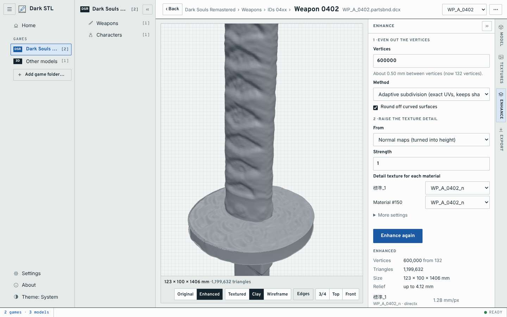
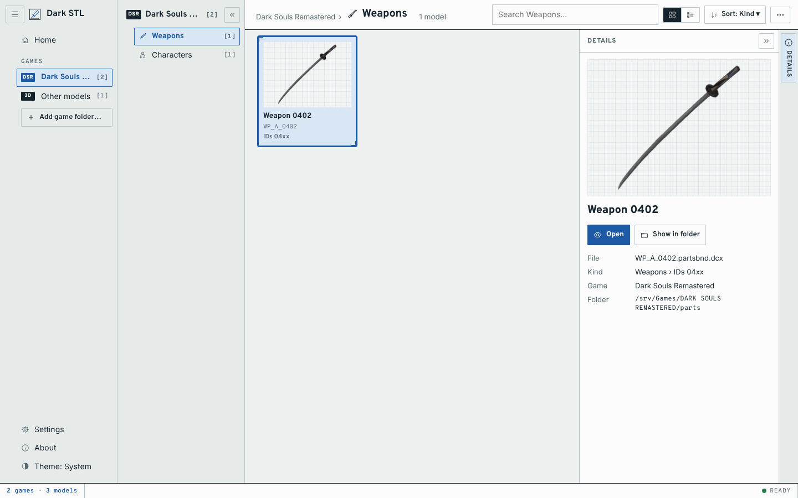

# Dark STL

Browse the models of Dark Souls, Bloodborne, Sekiro and Elden Ring (or any OBJ file), add the
surface detail their textures describe, and export print-ready meshes.



The game models are low-poly: most of their detail lives in normal maps. Dark STL turns that
detail into real geometry in three steps:

1. **Even out the vertices** to a target count, so flat areas get as many vertices as busy ones.
   Curved surfaces are rounded off along the model's own shading normals.
2. **Displace** every vertex by the height the normal map (or a height map) describes, at the
   physical scale the texture implies.
3. **Export** to STL, OBJ (with textures), PLY or GLB, in millimetres by default.

See [docs/PLAN.md](docs/PLAN.md) for how each step works, the file formats, and the roadmap.

## Status

Early. All readers and all three steps work and are tested against synthetic game files built
to the published format descriptions. Checked on real files so far: a Dark Souls Remastered
weapon, and a Bloodborne character, object and armour piece (PS4 textures included). The
other games come next (Phase 1 of the plan).

Importing is modular: each game family has its own importer, and everything after import
(the explorer, the three steps, export) is shared. FromSoftware files and Wavefront OBJ are
supported today.

## Install

**Windows:** download `DarkSTL_<version>_x64-setup.exe` from the
[releases page](https://github.com/DrFlGd/Dark-STL/releases) and run it. It needs no Python
and installs for your account only. It isn't signed, so SmartScreen asks once: *More info >
Run anyway*. The `-portable.zip` is the same app in a folder to run from anywhere. The app is
`Dark STL.exe`; its engine sits in the `engine` folder beside it, and `engine\darkstl.exe` is
also the command line. If the app has a problem, `%LOCALAPPDATA%\DarkSTL\cache\darkstl.log`
says why.

**From source** (any system): Python 3.10 or newer.

```
git clone https://github.com/DrFlGd/Dark-STL.git
cd Dark-STL
pip install -e ".[gui,remesh]"
```

`gui` adds pywebview, so the app opens in a window of its own; without it the app opens in
your web browser. `remesh` adds the optional isotropic remesher. The command line needs
neither.

## Getting the game files

Dark STL reads the files as the community unpackers leave them; it does not read the games'
encrypted archives directly.

- **PC games:** unpack them with the usual community unpacker for each game (UXM Selective
  Unpacker, or UDSFM for Dark Souls PTDE). Models end up in `parts/`, `chr/`, `obj/` or
  `asset/`, and `map/` as `.dcx` files, which Dark STL opens as they are.
- **Bloodborne:** use the extracted `dvdroot_ps4` folder from your own console dump, or any
  folder of `.chrbnd.dcx`, `.objbnd.dcx` and `.partsbnd.dcx` files taken from it. The PS4
  textures are rebuilt into ordinary DDS on the fly.
- Folders unpacked further with WitchyBND or Yabber (`wp_a_0210-partsbnd-dcx/`) work too.
- **Sekiro and Elden Ring** compress with Oodle. Dark STL uses the `oo2core_6_win64.dll`
  that ships with the game. It is found automatically when the model files are inside the
  unpacked game folder; otherwise point to it in *Settings > Oodle* (or `--oodle`).

## Using the app

Start *Dark STL* from the Start menu, or from a source install:

```
darkstl            # or darkstl-gui; darkstl gui --browser opens it in your browser
```

1. **Add your games.** *Add game folder…* takes a game's folder (once unpacked) or any folder
   of extracted model files. Dark STL recognises the game from its files and lists it in the
   menu. Add as many games and folders as you like; *Settings* lists them, with Rescan,
   Change game and Remove. Nothing in your folders is ever changed.
2. **Browse a game.** Each game has its own library: its kinds of model (weapons, armour,
   characters, objects, map pieces) as tiles, then each kind's models with a preview, in
   groups. Previews are drawn once and kept until you rescan the folder. Search with the box
   at the top (or press /). *Open a model file…* under ⋯ on
   Home opens a single file, including `.obj`.
3. **Open a model** (double-click or Enter). It's shown with the game's textures, wherever in
   the game folder they are (a map's texture packs, shared packs, another model's archive);
   *Model* lists its parts and options, *Textures* every texture found. A file that holds several
   models (a weapon and its sheath) has a switch at the top.
4. **Generate** sets the vertex count (it shows the spacing that gives on this model) and where
   the detail comes from, then makes the detailed model. Show *Original* or *Enhanced* under
   the view: both stay loaded, so switching is instant. The last three models generated are
   kept too, so generating again with settings you've already used is instant. Click the job
   in the status bar (or Stop under the progress bar) to stop it.
5. **Export** writes STL, OBJ, PLY or GLB, in millimetres by default.



## Command line

```
darkstl scan "D:/Games/DARK SOULS III/Game"              # list models by game and type
darkstl info parts/wp_a_0210.partsbnd.dcx                # models, parts, materials, textures
darkstl textures parts/wp_a_0210.partsbnd.dcx -o tex/    # save every texture as PNG
darkstl export parts/wp_a_0210.partsbnd.dcx -o grip.obj  # original model with textures
darkstl enhance parts/wp_a_0210.partsbnd.dcx -o grip.stl -n 2000000
darkstl enhance chr/c2010.chrbnd.dcx -o c2010.stl -n 4000000 --strength 1.5 --save-heights heights/
```

Useful `enhance` options: `--method isotropic` for an exact count of uniform triangles,
`--source height` to use a grayscale height map, `--flat` to skip rounding, `--green
opengl|directx` if the relief comes out inverted, `--max-mm` to clamp displacement, and
`--parts 0,2` to keep only some parts, and `--variant WP_A_0402_1.flver` to pick a model in a
file that holds several (see `info`). Run `darkstl <command> -h` for all.

## Development

```
pip install -e ".[gui,remesh,dev]"
pytest
```

The tests build game files byte by byte (`tests/synth.py`), so no game data is needed or
stored in the repository. `tests/test_page.py` also drives the page in Chromium when
Playwright is installed (`pip install playwright && python -m playwright install chromium`).

The page (`src/darkstl/web/`) needs no build step. Its interface comes from
[Model Library](https://github.com/DrFlGd/Model-Library): `styles.css`, `lib/`, and the
layout, inspector, menu and icon modules in `ui/` are shared with it, so changes there are
best made in both.

To support another game, write an importer (see `src/darkstl/importers/base.py` and the
OBJ importer as a short example) and add it to `IMPORTERS` in `importers/__init__.py`.

The Windows app (`desktop/`) is a [Tauri](https://tauri.app) app, like Model Library's. Its
window shows the same page, and the page reaches the engine through the window
(`web/platform-desktop.js`, `desktop/src/main.rs`): the window runs `darkstl engine`
(`app/engine.py`) and passes the page's commands to it over its stdin and stdout, so the
app opens no port. The engine is frozen with PyInstaller (`desktop/engine/engine.spec`, with
only the parts of VTK the remesher needs) and bundled beside the app. To build it, with Rust
and Node installed:

```
pip install ".[remesh]" pyinstaller
pyinstaller desktop/engine/engine.spec --noconfirm --distpath build --workpath build/pyinstaller
python desktop/engine/smoke.py build/engine
cd desktop && npx @tauri-apps/cli@2 build
```

`desktop/drive.py` drives the built app through tauri-driver (WebDriver). The Windows app
workflow does all of this on every pull request that touches the app.

Releases publish themselves: once the tests pass on main and the version in
`pyproject.toml` has no release yet, the Release workflow builds the Windows app, the wheel
and the source archive, and releases them as `v<version>`, with `docs/releases/v<version>.md`
as the notes. To release, bump the version (in `pyproject.toml`, `src/darkstl/__init__.py`
and `desktop/Cargo.toml`, then `cargo update -p dark-stl` in `desktop/`), add the notes, and
merge.

## Credits

The file format knowledge comes from the FromSoftware modding community, in particular
[SoulsFormats](https://github.com/JKAnderson/SoulsFormats) by TKGP and
[Soulstruct](https://github.com/Grimrukh/soulstruct) by Grimrukh. Dark STL is an independent
reimplementation and contains no code or data from the games; you need your own copies.

The page bundles [Preact](https://preactjs.com) (MIT), [htm](https://github.com/developit/htm)
(Apache 2.0) and [three.js](https://threejs.org) r186 (MIT), unmodified apart from import
paths; their licences are in `src/darkstl/web/vendor/`.
