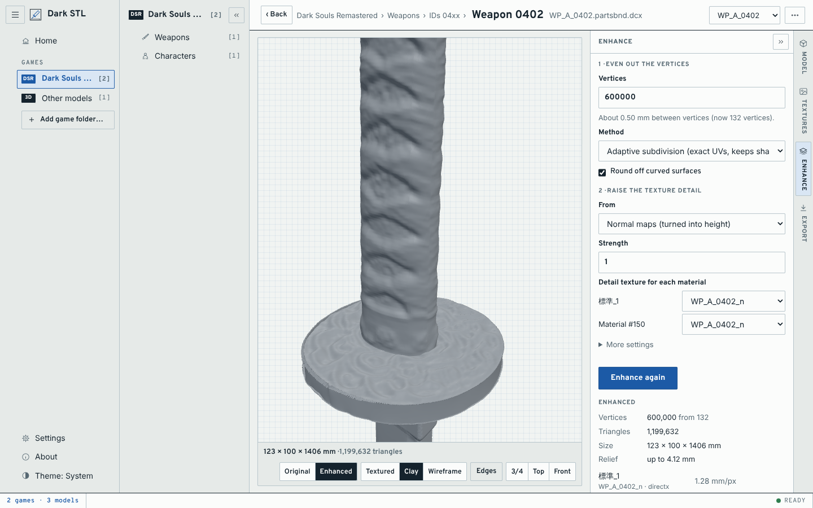
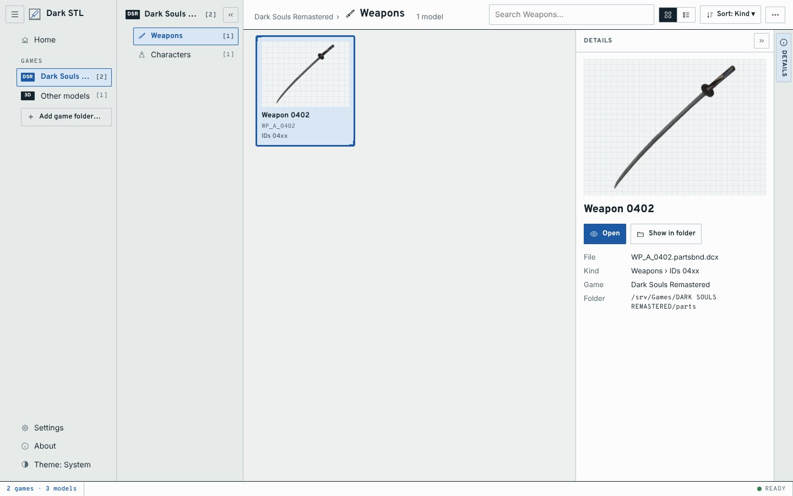

# Dark STL

Open the models of your games, keep them in a library you can search and organise across every
game, and get them ready to print: clean off what shouldn't be printed, pose them, and turn the
surface detail their textures describe into real geometry.



- **Import.** Dark STL reads models, textures, skeletons and animations straight from a game's
  install folder, its archives unpacked, decrypted and decompressed on the way, or from files other
  tools exported (OBJ, glTF, FBX, PSK). Each game family has its own importer and everything after
  it is shared. *Collect into the app* keeps a model, or a whole game, as model packages in
  Dark STL's own library, so every feature keeps working after the game is uninstalled.
- **Library.** Each game gets a library of its own, with models named as the game names them,
  sorted into kinds and groups, and previews that turn when you point at them. One search looks
  through every game. Collections, tags and stars cut across games, related models (an armour
  set, a weapon's sheath) are linked, and a queue runs actions on many models at once.
- **Manipulate and clean.** Put configurable weapons together from their parts, pose a model
  with the game's animations or by turning its bones, attach a weapon to a hand, choose another
  texture for a material, and take off hidden parts, thin cloth and any faces you pick.
- **Enhance.** Game models are low-poly, and most of their detail lives in normal maps. Dark STL
  evens out the vertices to the count you choose, then displaces every vertex by the height the
  normal map (or a height map) describes, at the physical scale the texture implies, while keeping
  thin parts from being pushed through themselves.
- **Export** to STL, OBJ (with textures), PLY or GLB (posed, with its skeleton), in millimetres.

Print finishing belongs to the companion app [Model Painter](https://github.com/DrFlGd/Model-Painter):
making a model watertight, cutting it into pieces with joints, and painting it from its textures for
a multi-colour printer. *Export for Model Painter* on the Export tab hands a model over in one click.
Dark STL's own Finish and Cut tabs and its painted 3MF export moved there in 0.55.0.

See [docs/PLAN.md](docs/PLAN.md) for how each step works, the file formats, and the roadmap.

## Status

In active development: the [releases page](https://github.com/DrFlGd/Dark-STL/releases) has the
latest version and what each one changed. Every reader and step is tested against synthetic game
files built byte by byte to the published format descriptions. Checked on real files so far: Dark
Souls Remastered weapons, a Bloodborne character, object and armour piece (PS4 textures included),
a whole Dark Souls install collected as packages, Borderlands 2 guns with their skins, and Returnal
models posed with the game's animations. The other games have only been read from synthetic files
so far; Phase 1 of the [roadmap](docs/PLAN.md#roadmap) lists what is still to check.

Supported today:

- **FromSoftware:** Dark Souls (PTDE and Remastered), Dark Souls III, Bloodborne, Sekiro, Elden
  Ring. Dark Souls II's models are listed too; its own texture layout is still to come.
- **Cyberpunk 2077** (REDengine 4).
- **Capcom RE Engine:** Resident Evil 2, 3, 4, 7 and Village, Devil May Cry 5.
- **Borderlands:** Borderlands, Borderlands 2, The Pre-Sequel (Unreal Engine 3), Borderlands 3,
  Tiny Tina's Wonderlands, Borderlands 4.
- **Returnal**, and **any other Unreal Engine 4 or 5 game** through a game profile.
- **Grand Theft Auto:** III, Vice City, San Andreas, IV (with its episodes) and V (PC).
- **DOOM Eternal** (id Tech 7) and **DOOM: The Dark Ages** (id Tech 8). DOOM (2016) and DOOM VFR
  come next.
- **Files from other tools:** Wavefront OBJ, glTF and GLB, FBX, ActorX PSK and PSKX.

## Install

**Windows:** download `DarkSTL_<version>_x64-setup.exe` from the
[releases page](https://github.com/DrFlGd/Dark-STL/releases) and run it. It needs no Python
and installs for your account only. It isn't signed, so SmartScreen asks once: *More info >
Run anyway*. The `-portable.zip` is the same app in a folder to run from anywhere. The app is
`Dark STL.exe`; its engine sits in the `engine` folder beside it, and `engine\darkstl.exe` is
also the command line. If the app has a problem, `%LOCALAPPDATA%\DarkSTL\cache\darkstl.log`
says why.

For watertight models, cutting into pieces and colour painting, install
[Model Painter](https://github.com/DrFlGd/Model-Painter/releases) too. Dark STL finds it where its
installer or its portable zip put it.

**From source** (any system): Python 3.10 or newer.

```
git clone https://github.com/DrFlGd/Dark-STL.git
cd Dark-STL
pip install -e ".[gui,remesh]"
```

`gui` adds pywebview, so the app opens in a window of its own; without it the app opens in
your web browser. `remesh` adds the optional isotropic remesher. The command line needs
neither.

## Getting the game files

- **PC games (Dark Souls PTDE, Dark Souls II, Dark Souls III, Sekiro, Elden Ring):** add the
  game's install folder as it is. Its models are still packed in the game's archives
  (`Data0.bhd`/`.bdt` and so on), so Dark STL offers to **unpack** them (also *Unpack…* in the
  folder's menu, and *Settings > Game archives*): it decrypts the archives' file lists with
  the games' published keys and writes out the groups you choose (characters, weapons and
  armour, objects and assets, map pieces) with their textures and animations, into its own
  library folder, laid out as `chr/`, `parts/`, `obj/` or `asset/`, and `map/`. Nothing in
  the game's folder is changed, and nothing else (sound, scripts, collision) is unpacked.
  File names come from the community's lists (UXM's, as Smithbox ships them, are included;
  newer ones, which name Elden Ring's Shadow of the Erdtree files, download from
  UXM Selective Unpacker in *Settings*), and models that follow the pattern of known names
  are found too. From the command line: `darkstl unpack <game folder> -o <folder>
  [--only characters,parts,objects,maps]`. A folder already unpacked with UXM Selective
  Unpacker or UDSFM works as it is.
- **Bloodborne:** use the extracted `dvdroot_ps4` folder from your own console dump, or any
  folder of `.chrbnd.dcx`, `.objbnd.dcx` and `.partsbnd.dcx` files taken from it. The PS4
  textures are rebuilt into ordinary DDS on the fly.
- Folders unpacked further with WitchyBND or Yabber (`wp_a_0210-partsbnd-dcx/`) work too.
- **Sekiro and Elden Ring** compress with Oodle. Dark STL uses the `oo2core_6_win64.dll`
  that ships with the game. It is found automatically when the model files are inside the
  unpacked game folder; otherwise point to it in *Settings > Oodle* (or `--oodle`).
- **Cyberpunk 2077:** add the game's install folder as it is. Its `.archive` files are read
  directly (the first scan reads through them once to learn the models' names, and keeps
  what it found), using the game's own `bin\x64\oo2ext_7_win64.dll` to decompress. A folder
  of `.mesh` and `.xbm` files exported with WolvenKit (kept under their `base\...` paths)
  works too, and the two can be mixed: a model's textures are looked up in the loose folder
  first, then in the archives. Weapons are listed as configurable models, put together from the
  game's own appearance files (`.app`): the body, a slot for each part the appearances swap
  (magazine, stock, decals...), the body's finish, and the attachment points (scope, muzzle) with
  the attachments that fit them; each in-game appearance (*frank*, *military1*...) is a preset.
  Multilayered materials (most weapon surfaces, skin) are blended from their layers and masks
  into one colour map and one normal map.
- **Resident Evil (RE Engine):** add the game's install folder as it is: Dark STL reads the
  models straight from its `.pak` archives. Paks only store hashes of the file names; the
  names come from the community file lists Dark STL ships (Ekey's, from
  [REE.PAK.Tool](https://github.com/Ekey/REE.PAK.Tool), cut to meshes, textures,
  materials and animations) for Resident Evil 2, 3, 7 (both the ray-tracing and the original releases), 4,
  Village and Devil May Cry 5. After a game update, a newer `.list` file put in the game's
  folder is read too. A folder extracted with a pak tool (REtool, ree-pak), holding
  `natives/`, works as well.
  Models are `.mesh` files with their materials in a `.mdf2` and textures in `.tex` files;
  the full-size textures and the most detailed geometry of newer games (Resident Evil 4) sit
  under `natives/stm/streaming/` and are used when present. Characters can be posed on the
  Pose tab with the game's `.motlist` animations filed under their id (`pl0000`, `cha0`...). Games whose archives are
  encrypted (Monster Hunter Wilds and later) need extracting first; their GDeflate textures
  are not read yet.

- **Borderlands, Borderlands 2, The Pre-Sequel (Unreal Engine 3):** add the game's install
  folder as it is. The models are read straight from the `.upk` packages in
  `WillowGame\CookedPCConsole` (`CookedPC` for the first game), LZO-compressed as they are;
  the large texture mips come from the `.tfc` texture caches beside them. The first scan
  opens every package once and keeps what it found. Borderlands 2 and The Pre-Sequel keep
  every gun part of a weapon type in one shared mesh in `Startup.upk`; it is listed under
  Weapons with each part as a part of the model, and each weapon type is also a
  configurable model (body, grip, barrel, sight, stock, elemental, accessory) built from the
  game's own part definitions in the `GD_Weap_*` packages.

- **Borderlands 3, Tiny Tina's Wonderlands (Unreal Engine 4), Borderlands 4 (Unreal Engine 5):**
  add the game's install folder as it is. Models are read from the `.pak` files (BL3, Wonderlands)
  or the IoStore `.utoc`/`.ucas` containers (BL4) in `OakGame\Content\Paks`. Encrypted files need
  the game's AES key (Borderlands 3's is included; paste others in *Settings > Unreal games* or
  put them in `unreal-keys.txt` in the game folder). Borderlands 4 also needs a `.usmap` type
  mappings file for the installed version of the game, added the same way, because it cooks
  its objects without property names. Guns are configurable from their part meshes, the slots
  guessed from the part names.

- **Returnal (Unreal Engine 4):** add the game's install folder as it is. Models are read from the
  `.pak` files in `Returnal\Content\Paks`, sorted into weapons, characters (Selene, creatures),
  map pieces and objects by their folders. Returnal cooks its objects without property names: Dark
  STL finds each mesh's and texture's own data past them, and picks a material's textures by their
  names. A `.usmap` type mappings file for the installed version, if you have one, lets it read the
  materials' settings instead (game folder or *Settings > Unreal games*). Dark STL doesn't include
  Returnal's AES key: if the paks are encrypted, paste the key there too and rescan.

- **Any other Unreal Engine 4 or 5 game:** add the game's install folder as it is. Dark STL sees
  that it's an Unreal game and asks for its name, then reads its skeletal and static meshes with
  their textures from the `.pak` files or IoStore containers, sorted into kinds and groups by the
  folders the game keeps them in, and named from its string tables. Locked `.pak` files need the
  game's AES key (*Settings › Game tools › Unreal games*, or `unreal-keys.txt` in its folder). How a
  game is read is kept in a small JSON game profile: *Settings › Game tools › Game profiles* lists
  them, and a copy in your profiles folder can change how its models are sorted, named and
  textured (see [docs/profiles.md](docs/profiles.md)).

- **Grand Theft Auto III, Vice City, San Andreas (RenderWare, PC):** add the game's install
  folder as it is. Models (`.dff`) and their texture dictionaries (`.txd`) are read straight from
  the `.img` archives (`models\gta3.img` with its `gta3.dir` in III and Vice City, the single-file
  `VER2` archives in San Andreas) or loose. The game's own lists (`data\gta.dat`, `default.dat`
  and the `.ide` files they name) sort them into characters, vehicles, weapons, map pieces and
  objects, and say which dictionary each model's textures are in; vehicles are named as in the game
  (from `text\american.gxt`). Cars are built with their wheels on every axle, without their damaged
  and low-detail panels (both can be turned on), and painted in each colour pair from
  `data\carcols.dat` (a variant each). Characters are posed on the Pose tab with `anim\ped.ifp`.
  A folder of `.dff` and `.txd` files exported with another tool opens too, its textures looked
  up by name. The Definitive Edition (Unreal Engine 4) isn't read by this importer.

- **Grand Theft Auto V (PC, the original release and Enhanced):** add the game's install folder as
  it is (the one with `GTA5.exe`). Models are read straight from the `.rpf` archives, nested ones and
  the `update` and DLC archives included (an update's copy wins). The archives are encrypted with
  keys that are in the game's executable: Dark STL doesn't include them, but finds them in your
  `GTA5.exe` the first time (this reads through the executable once, which takes a while) and keeps
  them in its settings folder (`keys\gta5.bin`). Vehicles (`.yft`) are sorted by class and named as
  in the game (from `vehicles.meta` and the `.gxt2` text), with a wheel on every corner; characters
  (`.ydd`) are listed as outfits, a slot for each component (top, legs, feet, hair...), and posed on
  the Pose tab with the game's clips (`.ycd`); weapons are named and grouped from `weapons.meta`;
  props and map pieces are grouped by archive. Textures come from the model's `.ytd`, its parents in
  `gtxd.meta` and the shared vehicle dictionaries. Files exported with OpenIV or CodeWalker (`.ydr`,
  `.ydd`, `.yft` with their `.ytd`) open too, without the keys. Vehicle paint colours aren't applied
  yet (painted panels show their base texture).

- **Grand Theft Auto IV (PC, with The Lost and Damned and The Ballad of Gay Tony):** add the game's
  install folder as it is (the one with `GTAIV.exe`). Models (`.wdr`, `.wdd`, `.wft` with their
  `.wtd` textures) are read straight from the `.img` archives in `pc\models\cdimages` and
  `pc\data\maps`. The archives' tables are encrypted with a key that is in `GTAIV.exe`: Dark STL
  doesn't include it, but finds it there the first time and keeps it in its settings folder
  (`keys\gta4.bin`). The game's `.ide` files and `american.gxt` sort and name the vehicles; peds are
  outfits of their components, as in GTA V; the episodes' models are listed with the base game's,
  their groups named after the episode. GTA IV's animations aren't read yet, so its characters
  can't be posed. Files exported with OpenIV or SparkIV open too.

- **DOOM Eternal (id Tech 7):** add the game's install folder as it is. Models are read from the
  `.resources` containers and `.streamdb` files in `base` (the first scan reads through them once;
  the game's `meta.resources` says which copy of a file is the current one): skinned models
  (`.md6mesh`: demons, the Slayer, weapons) with their skeletons and animations for the Pose tab,
  and static models (`.lwo`: props, pickups, map pieces), with the textures their `material2` decls
  name. They're sorted into characters, weapons, objects and map pieces by their folders. The game
  compresses its files with Oodle: Dark STL uses the game's own `oo2core_8_win64.dll`, which is
  beside `DOOMEternalx64vk.exe`, and finds it by itself (or point to it in *Settings › Game tools › Oodle*; on
  Linux or macOS use a `liboo2corelinux64.so` or `libkraken` build). Collect writes each model's
  files decompressed, so the collected copy needs neither the game nor Oodle. Checked only on
  synthetic files built to Valen's description of the formats so far: the size (id units taken as
  inches) and the normal maps' green direction are still to be confirmed on the real game.

- **DOOM: The Dark Ages (id Tech 8):** add the game's install folder as it is; it's read like DOOM
  Eternal (its models, skeletons and animations have their own layouts, and longer animations are
  kept in the `.streamdb` files, which Collect copies too). The game doesn't ship the Oodle library
  (it's built into `DOOMTheDarkAges.exe`): Dark STL uses DOOM Eternal's `oo2core_8_win64.dll` by
  itself when Eternal is installed beside it in the same Steam library; otherwise point *Settings ›
  Game tools › Oodle* at an `oo2core_9_win64.dll` or Eternal's. Skinned models with six or eight
  joints per vertex keep the four heaviest. Vegetation and strand-hair models aren't read. Checked
  only on synthetic files so far.

- **Posing Unreal 4/5 models** (Returnal, Borderlands 3, Wonderlands, Borderlands 4): a skeletal
  mesh can be posed on the Pose tab with every `AnimSequence` made for its `Skeleton` asset. The
  first time a game's animations are listed, Dark STL reads the header of each package that looks
  like an animation (named `A_`, `AS_`, `Anim_`... or in an animation folder) and keeps what it found;
  for Returnal, whose animations may be named otherwise, it looks through every package that may be
  one when the names find none. When none are found, the Pose tab says what was looked through.
  Animations compressed with Unreal's own codecs are read (4.12 to 5.x); those compressed with the
  ACL plugin are counted on the Pose tab but not read yet.

- **Posing Borderlands, Borderlands 2 and The Pre-Sequel characters (Unreal Engine 3):** a skeletal
  mesh can be posed on the Pose tab with the sequences of every `AnimSet` in the game whose bones are
  the mesh's (listed as *AnimSet: sequence*). Nothing in the packages says which AnimSets a mesh
  uses, so the first time a game's animations are listed Dark STL lists the AnimSets of every package
  (a few minutes for Borderlands 2 when the folder was scanned with an earlier version) and keeps
  them; each is read from its own package, or from a map that carries a copy when that is all there
  is. Borderlands 2's polar-encoded rotations are read; the mesh keeps its own bone lengths unless
  the AnimSet moves them, as the game does. Gun meshes made of parts aren't posed.

- **Files from other tools:** add a folder of models exported with Blender, FModel, UModel, WolvenKit,
  OpenIV and the like, or open a single file with *Open a model file…* under ⋯ on Home. Wavefront
  `.obj` (with its `.mtl`), glTF (`.gltf`, `.glb`), FBX (binary or text, 6.1 to 7.7, read by Dark
  STL's own reader, with its skeleton and animations) and ActorX `.psk`/`.pskx` are read, their
  textures found from the paths the file keeps or by name beside it. They can be collected as
  packages like any game's models.

## Using the app

Start *Dark STL* from the Start menu, or from a source install:

```
darkstl            # or darkstl-gui; darkstl gui --browser opens it in your browser
```

### The library

1. **Add your games.** On first start, Home shows a tile for each game Dark STL reads: click one to
   see which folder to choose for it. *Add game folder…* takes a game's install folder (offering
   to unpack the games that keep their models in archives) or any folder of extracted or exported
   model files. Dark STL recognises the game from its files and lists it in the menu; an Unreal
   game it doesn't know is added under the name you give it. *Settings › Library* lists the
   folders, with Rescan, Change game and Remove. Nothing in your folders is ever changed.
2. **Browse a game.** Each game has its own library: its kinds of model (weapons, armour,
   characters, objects, map pieces) as tiles, then each kind's models in groups, as cards or as a
   list. Models show the name the game gives them (the file's name is under it), and each card its
   size and triangle count. Point at a card for a moment and its preview turns round the model;
   characters are drawn standing in a frame of an idle animation. The list view sorts by any
   column (name, kind, size, triangles, parts, textures, animations, collected), and a slider sets
   the card size. Previews are drawn once and kept until you rescan; *Redraw preview* (right-click
   a card) draws one again, and *Redraw previews here* under ⋯ a whole game, kind or group.
3. **Search every game.** The box at the top of the menu (or `/`) looks through every game's
   names, in-game names, file names and tags, with chips to narrow it by game, kind, animations,
   textures, triangle count and collected or not. Home lists the last models you opened.
4. **Organise.** *Rename or move…* gives a model your own name and folder (`Bosses`,
   `Weapons/Long swords`). *Add to collection…* (or drag cards onto a collection in the menu)
   makes lists that cut across games; *Tag…* and *Star* mark models, and *Starred* lists them.
   A card says "3 related" when other models go with it (the rest of an armour set, a weapon's
   sheath, a character's face, body and hair), and *Combine with other models…* makes one model of
   several. All of this is kept in Dark STL's settings, keyed by each model's place in its game, so
   it survives rescans, collecting and uninstalling the game.
5. **Do things to many models at once.** Shift+click, Ctrl+click or Ctrl+A choose several; right-click
   them to *Collect into the app*, *Export as GLB*, *Export packages*, *Enhance with the current
   settings*, add them to a collection, tag or star them. The **Queue** page runs these one after
   another while you go on working, and says what each did.
6. **Problems.** A game's page lists what needs a look, each with the button that fixes it: a folder
   still packed, files gone since the scan, models that couldn't be read, textures that weren't found,
   animations that couldn't be read.
7. **Collect into the app.** Copies the models you choose, or a whole game, into Dark STL's library
   folder as model packages: the mesh with its skeleton and materials, its textures and animations
   (optionally every texture of the game, with the size estimated first). The game can then be
   uninstalled. The library folder can be moved in *Settings*; on a fresh install, *Add collected
   files…* lists it without the games.



### A model's page

Open a model with a double-click or Enter. It's shown with the game's textures, wherever in the
game folder they are. The tabs on the right are grouped as the work goes, and after each step
the buttons under its result take you on to the next.

**Model**

- **Configure** (configurable models): put a weapon together from its parts, a choice per slot
  (barrel, grip, magazine, sight...), with the game's own presets and skins.
- **Model** lists the parts, the options and the related models. A file that holds several models
  (a weapon and its sheath) has a switch at the top. When a model doesn't open, pose or texture as
  it should, *Export model files…* (under ⋯) puts its files and a report of what Dark STL made of
  them into one zip to send for review.
- **Textures** lists every texture found. *Change…* beside a material's colour, normal or height
  map opens the texture picker, which searches the whole game's textures by name. The normal maps
  can be cleaned up and upscaled for displacement, compared **Before / After** (drag the line, zoom
  into single texels).
- **Pose** plays the game's animations at any frame. Turn any bone on top of the frame (sliders, or
  drag the rings in the 3D view), mirror left and right, save poses (offered to every model with
  the same skeleton), and attach another model to a bone or socket: a sword in a hand, a shield on
  an arm.

**Edit**

- **Clean** takes off what shouldn't be printed, as a list of steps you can take away again: parts
  left out, parts and faces hidden inside others, thin sheets (capes, linings, cloth drawn from both
  sides, even inside a bigger part: listed biggest first, shown in the 3D view as you point at them,
  removed when ticked), and faces you pick by clicking the model (the pick spreads to the creases;
  Shift adds, Alt takes away). It also fills small holes, drops duplicate faces, welds vertices,
  turns flipped faces, and sets the print height, turns, mirror and place (from then on sizes read
  in print millimetres). Every later tab works on the cleaned model.
- **Mesh** evens out the vertices: set the count (it shows the spacing that gives on this model)
  and the method, then *Even out the vertices*. The mesh is kept while you work on Displace.
- **Displace** raises the texture detail on the evened-out mesh: the strength, a detail texture for
  each material and the finer settings. Thin parts (a blade's edge, a claw, a cape close to the body)
  get only as much relief as they have room for, so they aren't pushed through themselves. The
  **Thickness** view under the 3D view colours what is too thin to print at the height you give.
  Show *Original* or *Enhanced* under the view to compare, and *Save as variation* keeps an
  enhanced model, with the settings it was made with, beside the model to show, export or start
  from again. Click **Stop** in the status bar to stop a job.

To make a model watertight, cut it into pieces with joints or paint it for a colour printer, export
it for Model Painter (below): those moved there in 0.55.0.

**Export**

- **Export for Model Painter**, at the top of the tab, writes a GLB with its textures and materials,
  and **Open in Model Painter** opens it there, to make it watertight, cut it or paint it (Dark STL
  finds Model Painter where its installer put it, or set it in *Settings › General*).
- **Export** writes STL, OBJ, PLY or GLB, in millimetres by default, of the original or enhanced
  model. A GLB keeps the skeleton in the pose you made, so Blender opens it posed and rigged.

## Command line

```
darkstl scan "D:/Games/DARK SOULS III/Game"              # list models by game and type
darkstl info parts/wp_a_0210.partsbnd.dcx                # models, parts, materials, textures
darkstl textures parts/wp_a_0210.partsbnd.dcx -o tex/    # save every texture as PNG
darkstl export parts/wp_a_0210.partsbnd.dcx -o grip.obj  # original model with textures
darkstl export chr/c2010.chrbnd.dcx -o c2010.glb       # with its textures, for Model Painter
darkstl enhance parts/wp_a_0210.partsbnd.dcx -o grip.stl -n 2000000
darkstl enhance chr/c2010.chrbnd.dcx -o c2010.stl -n 4000000 --strength 1.5 --save-heights heights/
darkstl export chr/c2010.chrbnd.dcx -o c2010.stl --clean hidden-parts --clean sheets:0.5 --clean height:150
darkstl export chr/c1120.chrbnd.dcx -o c1120.stl --pose a000_003000@12      # posed at frame 12 of an animation
```

Useful `enhance` options: `--method isotropic` for an exact count of uniform triangles,
`--pose ANIMATION@FRAME` to pose the model with one of its animations (see `info`),
`--thin-room 60` for how much of the room inside thin parts the relief may use (`--no-thin-parts` to let it pass through),
`--source height` to use a grayscale height map, `--flat` to skip rounding, `--green
opengl|directx` if the relief comes out inverted, `--max-mm` to clamp displacement, and
`--parts 0,2` to keep only some parts, `--clean` steps done first (repeatable: `hidden-parts`,
`hidden-faces:2`, `sheets:0.5`, `holes:5`, `duplicates`, `weld:0.01`, `normals`, `height:150` or `scale:0.1`,
`rotate:0,0,90`, `mirror:x`, `floor`), and `--variant WP_A_0402_1.flver` to pick a model in a
file that holds several (see `info`). Run `darkstl <command> -h` for all. Making a model watertight,
cutting it into pieces and painting a 3MF are done in Model Painter: export a `.glb` and open it
there (`-o model.3mf` says so and stops).

## Development

```
pip install -e ".[gui,remesh,dev]"
pytest
```

The tests build game files byte by byte (`tests/synth.py`), so no game data is needed or
stored in the repository. `tests/test_page.py` also drives the page in Chromium when
Playwright is installed (`pip install playwright && python -m playwright install chromium`).

The page (`src/darkstl/web/`) needs no build step. Its interface comes from
[Model Library](https://github.com/DrFlGd/Model-Library): `styles.css`, `lib/`, and the
layout, inspector, menu and icon modules in `ui/` are shared with it, so changes there are
best made in both.

A game on an engine Dark STL already reads may need only a game profile: a JSON file in
`src/darkstl/importers/profiles/` (or the settings folder's `profiles/`) that says how its folder is
recognised and how its models are sorted, named and textured ([docs/profiles.md](docs/profiles.md)).
To support another engine, write an importer (see `src/darkstl/importers/base.py` and the OBJ
importer as a short example) and add it to `IMPORTERS` in `importers/__init__.py`.
[docs/PLAN.md](docs/PLAN.md) describes every importer, the shared steps and the roadmap.

The Windows app (`desktop/`) is a [Tauri](https://tauri.app) app, like Model Library's. Its
window shows the same page, and the page reaches the engine through the window
(`web/platform-desktop.js`, `desktop/src/main.rs`): the window runs `darkstl engine`
(`app/engine.py`) and passes the page's commands to it over its stdin and stdout, so the
app opens no port. The engine is frozen with PyInstaller (`desktop/engine/engine.spec`, with
only the parts of VTK the remesher needs) and bundled beside the app. To build it, with Rust
and Node installed:

```
pip install ".[remesh]" pyinstaller
pyinstaller desktop/engine/engine.spec --noconfirm --distpath build --workpath build/pyinstaller
python desktop/engine/smoke.py build/engine
cd desktop && npx @tauri-apps/cli@2 build
```

`desktop/drive.py` drives the built app through tauri-driver (WebDriver). The Windows app
workflow does all of this on every pull request that touches the app.

Releases publish themselves: once the tests pass on main and the version in
`pyproject.toml` has no release yet, the Release workflow builds the Windows app, the wheel
and the source archive, and releases them as `v<version>`, with `docs/releases/v<version>.md`
as the notes. To release, bump the version (in `pyproject.toml`, `src/darkstl/__init__.py`
and `desktop/Cargo.toml`, then `cargo update -p dark-stl` in `desktop/`), add the notes, and
merge.

## Credits

The file format knowledge comes from the FromSoftware modding community, in particular
[SoulsFormats](https://github.com/JKAnderson/SoulsFormats) by TKGP and
[Soulstruct](https://github.com/Grimrukh/soulstruct) by Grimrukh. Unpacking follows the
archive format as BinderTool (Atvaark), UXM (TKGP) and
[UXM Selective Unpacker](https://github.com/Nordgaren/UXM-Selective-Unpack) (Nordgaren)
read it; the archive keys and the bundled file lists are copied from
[Smithbox](https://github.com/vawser/Smithbox) (MIT, see
`src/darkstl/importers/fromsoft/filelists/LICENSE.txt`). The id Tech 7 and 8 formats (DOOM Eternal, DOOM: The Dark Ages) follow
[Valen](https://github.com/jandk/valen) by jandk (MIT) and
[EntityAtlan](https://github.com/FlavorfulGecko5/EntityAtlan) by FlavorfulGecko5 (MIT). Dark STL is an independent
reimplementation and contains no code or data from the games; you need your own copies.

The page bundles [Preact](https://preactjs.com) (MIT), [htm](https://github.com/developit/htm)
(Apache 2.0) and [three.js](https://threejs.org) r186 (MIT), unmodified apart from import
paths; their licences are in `src/darkstl/web/vendor/`.
